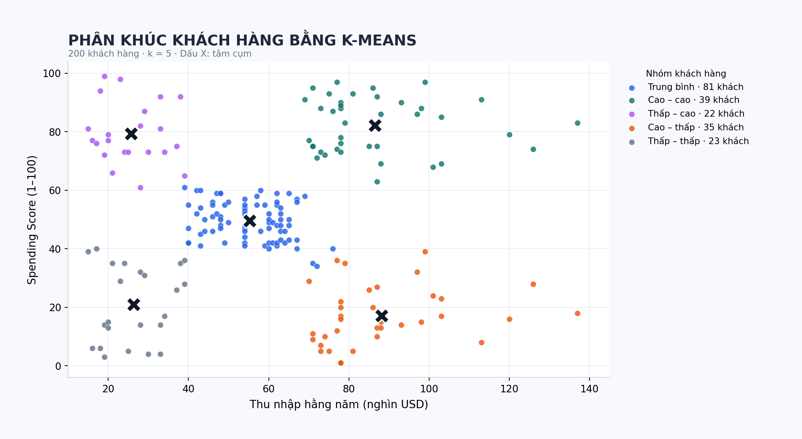
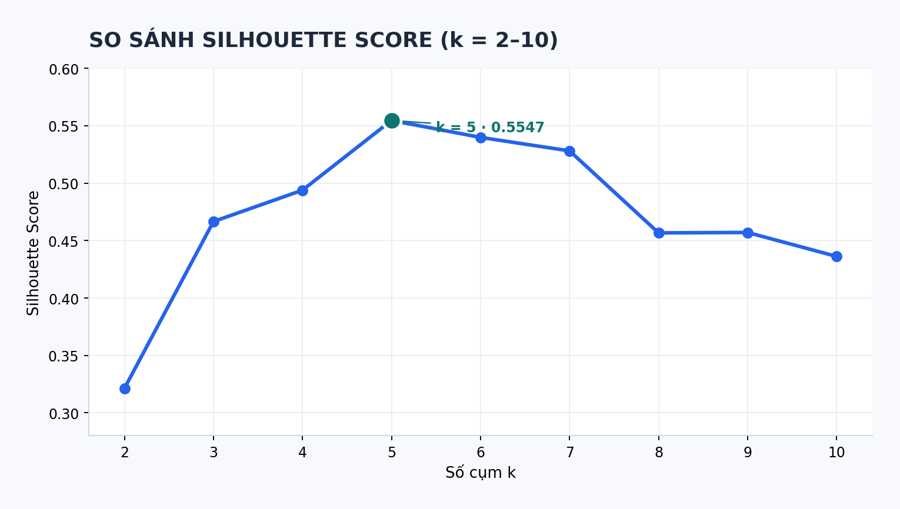
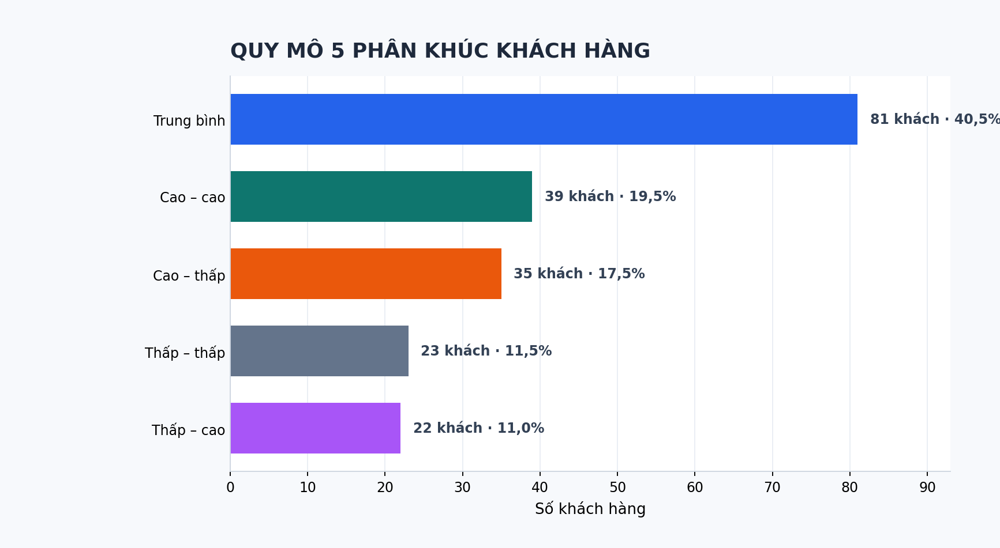
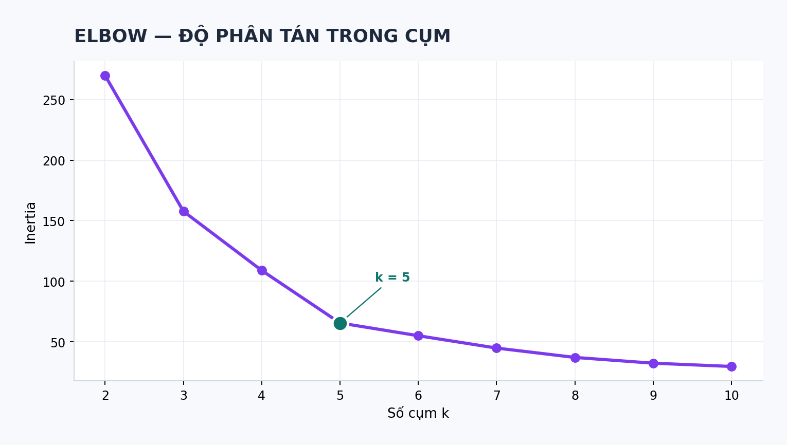

# Customer Behavior Analysis | Python & K-Means

**Phân khúc khách hàng bằng học máy không giám sát, đánh giá chất lượng mô hình và gợi ý thử nghiệm marketing dựa trên dữ liệu mẫu.**



Dự án sử dụng **Python, Pandas, scikit-learn, Matplotlib** để kiểm tra dữ liệu, mô tả khách hàng, chuẩn hóa đặc trưng, đánh giá số cụm và phân nhóm 200 khách hàng từ bộ dữ liệu *Mall Customers*. Trọng tâm là **phân khúc khách hàng** — khác với [Pizza Place (SQL/Power BI — doanh thu)](https://github.com/Huy054/Pizza-Place-Sales-Analysis) và [Superstore (Python/Power BI — lợi nhuận)](https://github.com/Huy054/superstore-data-analysis).

> **Lưu ý:** `Spending Score (1–100)` là một **điểm số**, không phải số tiền khách hàng thực chi. Dataset không có giá trị giao dịch, tần suất mua hay ROI, nên không thể xác nhận nhóm nào mang lại doanh thu lớn nhất hoặc hiệu quả chiến dịch thực tế.

## 1. Kết quả chính

| Chỉ số | Kết quả |
|---|---:|
| Tổng khách hàng | **200** |
| Số đặc trưng dùng phân cụm | **2**: Annual Income, Spending Score |
| Cụm được chọn | **k = 5** |
| Silhouette Score tại k = 5 | **0.5547** |
| Khoảng k đánh giá | **2–10** |
| Nhóm lớn nhất | **81 khách (40,5%)** |
| Mã khách hàng trùng / dữ liệu thiếu | **0 / 0** |

**Vì sao chọn k = 5?** `k = 5` cho Silhouette Score cao nhất trong các giá trị được thử (`2–10`) và có các nhóm dễ diễn giải bằng hai biến đầu vào. Đây là lựa chọn phù hợp **trong thí nghiệm này**, không phải bảo đảm sẽ tối ưu với dữ liệu hoặc đặc trưng khác.



## 2. Hồ sơ 5 nhóm khách hàng

| Nhóm mô tả | Số khách | Tỷ trọng | Thu nhập TB (nghìn USD/năm) | Điểm chi tiêu TB | Tuổi TB |
|---|---:|---:|---:|---:|---:|
| Thu nhập và chi tiêu trung bình | 81 | 40,50% | 55,30 | 49,52 | 42,72 |
| Thu nhập cao – Chi tiêu cao | 39 | 19,50% | 86,54 | 82,13 | 32,69 |
| Thu nhập thấp – Chi tiêu cao | 22 | 11,00% | 25,73 | 79,36 | 25,27 |
| Thu nhập cao – Chi tiêu thấp | 35 | 17,50% | 88,20 | 17,11 | 41,11 |
| Thu nhập thấp – Chi tiêu thấp | 23 | 11,50% | 26,30 | 20,91 | 45,22 |



**Các quan sát nổi bật:**

- Nhóm **thu nhập và chi tiêu trung bình** lớn nhất với **81 khách (40,5%)**.
- Có **39 khách (19,5%)** trong nhóm thu nhập cao – điểm chi tiêu cao và **35 khách (17,5%)** trong nhóm thu nhập cao – điểm chi tiêu thấp; hai nhóm có thu nhập trung bình gần nhau nhưng điểm chi tiêu khác xa.
- Hai nhóm có thu nhập thấp gồm **22 khách** có điểm chi tiêu cao và **23 khách** có điểm chi tiêu thấp. Vì chưa có dữ liệu mua hàng, các nhận định marketing mới là **giả thuyết để thử nghiệm**.

Đọc chi tiết: [Phân tích khách hàng và đề xuất Marketing (tiếng Việt)](docs/PHAN_TICH_KHACH_HANG_VI.md).

## 3. Phương pháp và đánh giá mô hình

1. **Data Quality:** xác nhận 200 khách, 5 cột, không NULL, không trùng `CustomerID`; kiểm tra độ tuổi, thu nhập và Spending Score thuộc khoảng hợp lý.
2. **EDA:** phân tích tuổi, giới tính, thu nhập và điểm chi tiêu; **không đưa tuổi/giới tính vào K-Means** trong dự án này.
3. **Feature Scaling:** chuẩn hóa `Annual Income (k$)` và `Spending Score (1-100)` bằng `StandardScaler`.
4. **Model Selection:** chạy K-Means với `k = 2–10`, `n_init=20`, `random_state=42`; so sánh **Inertia (Elbow)** và **Silhouette Score**.
5. **Segmentation:** huấn luyện k = 5 và mô tả tâm cụm trên **thang đo gốc**; đặt tên các nhóm theo đặc điểm, không phụ thuộc thứ tự mã Cluster.
6. **Stability Check:** thử thêm seed `7, 21, 42, 123`; trong lần chạy trên Colab của tác giả, **ARI = 1,00** với cả bốn seed, phản ánh tính nhất quán trong thử nghiệm này.
7. **Marketing Hypotheses:** đề xuất kiểm thử A/B và thu thập chỉ số doanh thu thực tế, không khẳng định tác động nhân quả.



## 4. File và cấu trúc repository

```text
customer-behavior-analysis/
├── README.md
├── data/
│   ├── Mall_Customers.csv                    # CSV gốc; 200 khách hàng
│   └── README.md
├── analysis/
│   └── Customer_Segmentation_Upgrade.ipynb  # Notebook Python chính thức
├── outputs/
│   ├── Customer_Segmentation_Result.csv     # 200 dòng + Cluster + Segment
│   ├── Cluster_Profile.csv                  # Hồ sơ 5 cụm
│   ├── KMeans_Evaluation.csv                # Inertia/Silhouette cho k=2–10
│   └── README.md
├── images/
│   ├── customer_clusters.png
│   ├── cluster_sizes.png
│   ├── silhouette_scores.png
│   └── elbow_inertia.png
├── docs/
│   ├── PHAN_TICH_KHACH_HANG_VI.md
│   └── PHUONG_PHAP_KIEM_DINH_MO_HINH.md
├── archive/                                  # Lưu bản cũ để đối chiếu
│   ├── README.md                             
│   ├── Customer_Segmentation.ipynb          
│   ├── Bieudo1.png                           
│   ├── Bieudo2.png                          
│   └── Bieudo3.png           
└── HUONG_DAN_CAP_NHAT_GITHUB.md
```


## 5. Cách chạy lại từ dữ liệu gốc

1. Mở `analysis/Customer_Segmentation_Upgrade.ipynb` trên [Google Colab](https://colab.research.google.com/) hoặc Jupyter Notebook.
2. Nếu chạy trên Colab, upload `data/Mall_Customers.csv` vào vùng `/content` với tên `Mall_Customers.csv`. Nếu chạy notebook từ **thư mục gốc repo**, code tự nhận đường dẫn `data/Mall_Customers.csv`.
3. Chọn **Runtime → Run all**; notebook kiểm tra dữ liệu, đánh giá `k` và tạo báo cáo 5 cụm.
4. Ba CSV kết quả được ghi vào thư mục `outputs/` **so với thư mục làm việc đang chạy notebook**. Có thể so sánh với ba file kết quả đã commit trong `outputs/` của repo.

**Kiểm tra nhanh:** dữ liệu 200 dòng, `k = 5`, Silhouette Score xấp xỉ **0,5547**, nhóm lớn nhất **81 khách**.

## 6. Giới hạn và đạo đức phân tích

- Bộ dữ liệu nhỏ (200 khách), dạng mẫu minh họa; chưa thể suy rộng sang thị trường thực tế.
- K-Means sử dụng chỉ **2 biến**; kết quả nhạy với lựa chọn biến, cách chuẩn hóa và dữ liệu mới.
- `Cluster 0/1/2/3/4` là mã tùy ý của mô hình. Tên phân khúc được gắn theo **đặc điểm tâm cụm**, không phải ý nghĩa cố định của con số.
- Không suy đoán khả năng thanh toán, nợ cá nhân hay phân biệt đối xử theo nhóm tuổi/giới tính. Mục đích là mô tả tổng hợp và thử nghiệm marketing phù hợp.
- Không xác nhận doanh thu/ROI khi dữ liệu không cung cấp giao dịch thực tế. Đề xuất ưu đãi hoặc chăm sóc khách hàng cần A/B test trước khi triển khai.

**Nguồn dữ liệu:** Mall Customer Segmentation Data (CSV mẫu, nguồn được ghi trong README repo gốc).
